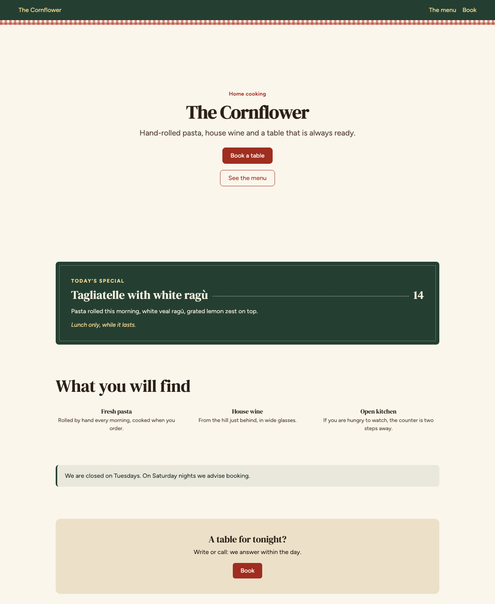
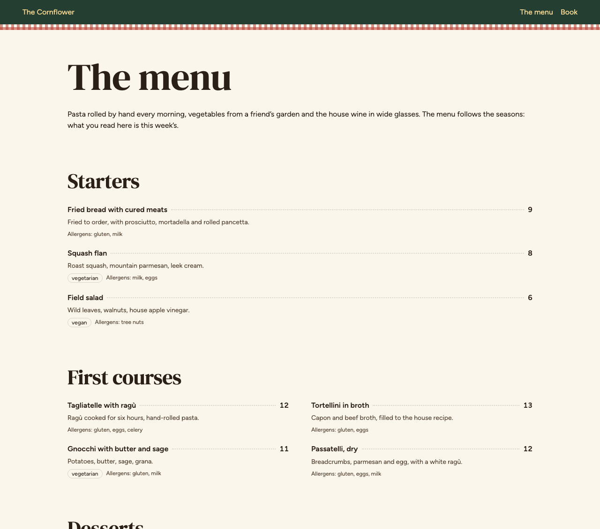
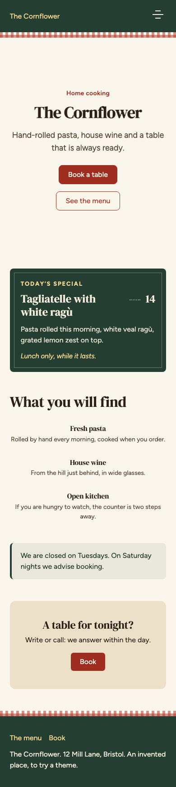

# Gingham — a Kometio theme, and how it was made

A theme for a restaurant, a bar, a bakery or a shop that sells food, named for
the checked cloth on the table: bread-paper behind the words, espresso for the
ink, a bottle-green band top and bottom with a strip of gingham along it, and a
tomato red for what the visitor is asked to do. It brings one block of its own,
a **Today's special** board.

It is also a worked example of making a [Kometio](https://github.com/kometio/kometio)
theme in a repository of its own, from nothing. Every file here is small, and
says in its comments why it is the way it is. If you have never made a theme,
read the steps below in order and then read the files; if you have, the table
tells you where to look.



The menu, with the dishes' prices set on a dotted leader, and the same page on
a phone:





## What is in it

| File                                           | What it does                                        | Where it sits on the ladder |
| ---------------------------------------------- | --------------------------------------------------- | --------------------------- |
| `theme.json`                                   | The manifest: the theme's name and two switches     | —                           |
| `theme.css`                                    | Colors, type, spacing, corners, shadows, motion     | 1. Tokens                   |
| `fonts.css`, `fonts/`                          | DM Serif Display and Figtree, as files of the theme | 1. Tokens                   |
| `regions/Header.astro`, `regions/Footer.astro` | The green bands, with the check                     | 3. Regions                  |
| `blocks/DailySpecial.*`                        | A block Kometio does not have                       | 4. A new block              |
| `Dockerfile`, `.github/workflows/build.yml`    | Builds the theme into Kometio's images              | Shipping                    |
| `env.d.ts`, `package.json`                     | Types for the editor, and what the build may import | —                           |

The ladder is the one in Kometio's
[docs/creating-a-theme.md](https://github.com/kometio/kometio/blob/main/docs/creating-a-theme.md):
reach for the lowest rung that gets you there, because each one up is more
surface to keep working when Kometio changes. Rung 2, replacing a block's own
markup, is not used here on purpose: this design never needed it, and a
replacement is a copy that has to follow core's fixes by hand.

## Make your own, step by step

### 1. The smallest theme

Two files in an empty repository:

```
theme.json   { "name": "my-theme", "allowStyleOverrides": true }
theme.css    :root { --primary: …; --background: …; --font-sans-value: …; }
```

`name` is what sites choose the theme by: lowercase letters, digits and dashes,
and not one of Kometio's own. Start `theme.css` from a copy of Kometio's
`themes/classic/theme.css` and rewrite the values. Every one of Kometio's
blocks is drawn from those custom properties, so this is already a theme.

Two things that are easy to get wrong, both written down in `theme.css` here:

- `--font-sans-value`, not `--font-sans`. The extra step is what lets a site
  owner's own font picker work later.
- Give every color token the theme lists. A missing one falls back to core's
  neutral default, which looks like a mistake and not a choice.

### 2. Try it

Copy the theme into a Kometio checkout (copy, not symlink, so the build sees it
as the builder image will) and build the public site with it:

```sh
rsync -a --delete --exclude node_modules --exclude .git ./ ../kometio/themes/gingham/
cd ../kometio
node tools/build-public-site-with-theme.mjs gingham
node --env-file=.env apps/public-site/server.mjs
```

Then choose the theme in the editor, in the Style dialog. A new theme is picked
up by a build, not by saving a file.

### 3. Fonts

Put the font's files in the theme and declare them in `fonts.css`; point
`--font-sans-value` (and `--kometio-heading-font`) at the family name the
`@font-face` declares, letter for letter. A near miss fails silently: the
browser falls through to the next font and the one you bundled never loads.
Never `<link>` to a font service: every visitor's address would go to a third
party. Keep the license file next to the font, and check you may redistribute it.

### 4. The header and the footer

`regions/Header.astro` and `regions/Footer.astro` replace only the element that
wraps the blocks. The blocks themselves are the site owner's, placed in the
editor; they arrive as the slot. Two things to know:

- A region that forgets `<slot />` makes the whole page disappear, with no
  warning.
- To change how the blocks inside look, do not style them one by one. Redefine
  the color tokens on the wrapper (the two files do) and every block inside
  follows.

### 5. A block of your own

Three files with the same name make one block, and the editor offers it as soon
as the theme is the site's, with nothing changed in Kometio:

- `DailySpecial.block.ts` says what it is: a schema, the fields, their defaults.
- `DailySpecial.astro` says how it is drawn. It must put the `instanceClass` it
  receives on the element it renders, or the owner's own colors do nothing.
- `DailySpecial.locales.json` says what the editor calls it and its fields, in
  each language.

### 6. Ship it

The simplest way is to upload it: download this repository as a zip (GitHub's
**Code → Download ZIP** works as it comes) and upload it in the editor, under
Style → Theme → **Upload a theme**. Kometio builds the site with it by itself
and offers to use it when it is ready, in a minute or two.

To ship the theme inside your own images instead:

```sh
docker build --target public-site -t my-agency/kometio-public-site .
docker build --target api -t my-agency/kometio-api .
```

The build runs on Kometio's published `kometio-public-site-builder` image, so it
needs no Kometio checkout. `KOMETIO_TAG` picks the Kometio version (default
`main`); the three Kometio images must share it. This repository's CI builds
both images on every pull request for `linux/amd64` and `linux/arm64`, and
publishes them from `main` as `ghcr.io/<owner>/kometio-theme-gingham-public-site`
and `ghcr.io/<owner>/kometio-theme-gingham-api`.

### 7. Before you call it done

1. Look at it in a browser, not only in the build output.
2. Look at a page with another theme active too: a rule that leaks is invisible
   on the theme you were designing.
3. Open the editor and put a block into the header and the footer.
4. Look at a page with nothing on it, and at a page with a lot.
5. Look at it on a phone, and with the browser asked for less motion.

## What is not here, and when you would need it

- **`locales.json`**: words the theme itself puts on the page, such as a sidebar's
  label. This theme writes none: what its block shows is the owner's text. Kometio's
  guide has the file's shape.
- **`icons/`**: an icon set of its own. Only needed if the design's icons are not
  Kometio's.
- **`blocks/<Name>.astro` for a block Kometio already has**: a replacement. Only
  to change what a block _is_; to change how it looks, tokens and a variant are
  enough and keep up with core by themselves.

## Fonts

DM Serif Display and Figtree are licensed under the SIL Open Font License 1.1;
the licenses are in `fonts/`.

## License

The theme itself (the stylesheets, the templates, the block and the regions) is
released under the MIT License: see `LICENSE`. The fonts in `fonts/` are not
covered by it; they keep the license above.
